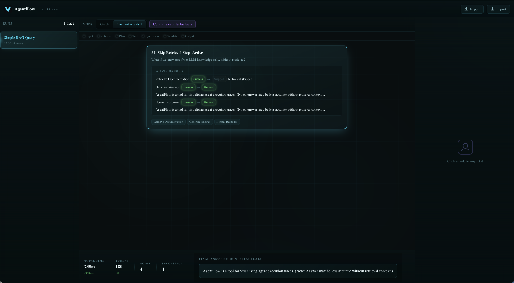
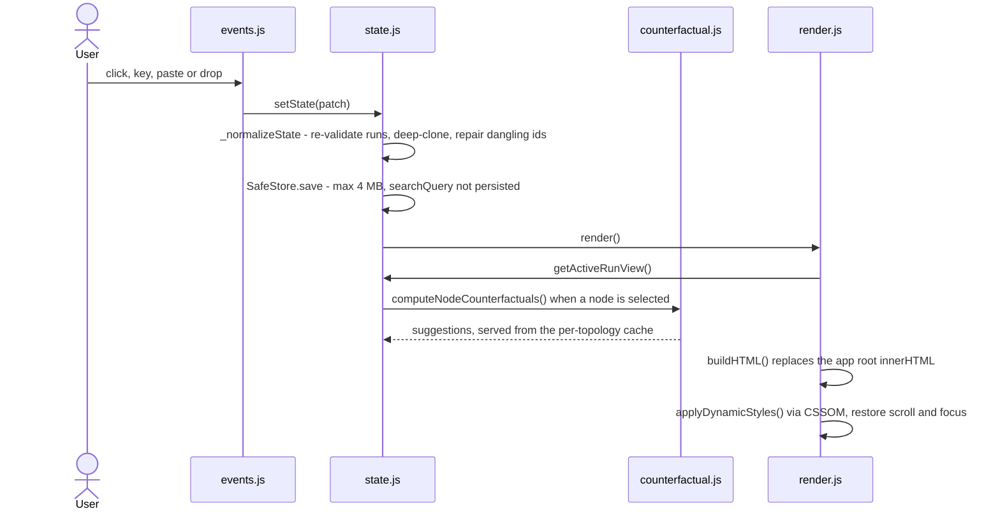
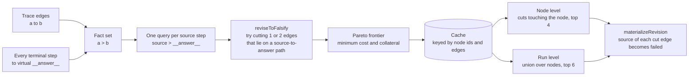
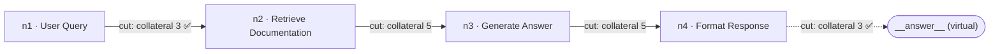

<div align="center">

# AgentFlow

**A client-side trace observer and counterfactual explorer for LLM agent runs.**

Import a trace from LangSmith, LangFuse or W&B Weave, inspect every step as a graph, and ask *"what if this step had failed?"*. Everything runs in your browser, with no backend, no build step and no runtime dependencies.

[](#testing)
[](#testing)
[](#architecture)
[](#architecture)
[](#security-model)
[](#security-model)
[](LICENSE)



</div>

---

## Contents

- [At a glance](#at-a-glance)
- [Quick start](#quick-start)
- [Using AgentFlow](#using-agentflow)
- [Architecture](#architecture)
- [Data model](#data-model)
- [Import adapters](#import-adapters)
- [Counterfactuals and the Logic Engine](#counterfactuals-and-the-logic-engine)
- [Security model](#security-model)
- [Performance](#performance)
- [Testing](#testing)
- [Deployment](#deployment)
- [Project structure](#project-structure)
- [Known issues and limitations](#known-issues-and-limitations)
- [License](#license)

---

## At a glance

| | |
|---|---|
| **Runtime** | 14 classic `<script>` files, 2,398 lines of vanilla JavaScript. No framework, no bundler, no transpiler. |
| **Dependencies** | None at runtime. There is no `package.json` and no build step: `public/` is deployed as-is. |
| **Data handling** | Traces never leave the browser. The code makes no `fetch`, XHR or WebSocket calls, and state persists only to `localStorage`. |
| **Inputs** | Native `.agentflow.json`, plus auto-detected LangSmith, LangFuse and W&B Weave exports. |
| **Counterfactuals** | Authored scenarios (`nodeOverrides`), plus scenarios computed by a built-in Logic Engine (minimum edge cuts, Pareto-ranked). |
| **Security** | CSP `default-src 'none'`, sha384 SRI on all 15 assets, HSTS preload, COOP/COEP/CORP, entity-escaping on every user string. |
| **Tests** | 603 Jest tests across 11 suites, passing on Node 18, 20 and 22. |

---

## Quick start

AgentFlow is a static site. Serve the `public/` folder over HTTP. Opening `index.html` straight from disk won't work, because assets use root-relative paths like `/js/main.js`.

```bash
git clone https://github.com/omryv/Agent-Flow.git
cd Agent-Flow
python3 -m http.server 8080 --directory public
```

Open <http://localhost:8080>, press <kbd>⌘</kbd>/<kbd>Ctrl</kbd>+<kbd>I</kbd>, and load any file from [`examples/`](examples):

| Example | Format | Shape |
|---|---|---|
| `simple.agentflow.json` | Native | 4-step RAG chain with one authored counterfactual |
| `langsmith.json` | LangSmith | Root chain with nested `child_runs` |
| `langfuse.json` | LangFuse | Trace with `observations` |
| `weave.json` | W&B Weave | Root call with nested `children` |

> A plain static server doesn't send the production security headers. The app works without them, because the headers only add restrictions. See [Deployment](#deployment) for the production setup.

---

## Using AgentFlow

### Three ways to import

| Method | How | Limits |
|---|---|---|
| **File dialog** | **Import** button or <kbd>⌘</kbd>/<kbd>Ctrl</kbd>+<kbd>I</kbd>. The dialog shows the detected format before you confirm. | `.json`, ≤ 2 MB |
| **Paste** | Paste JSON anywhere on the page, outside an input and with no dialog open. | Invalid or unrecognised JSON is silently ignored |
| **Drag and drop** | Drop a `.json` file on the page. | `.json`, ≤ 2 MB, errors shown as a toast |

Every import tries the **native schema first**. Only if that fails does it **auto-detect a third-party format**, and the adapter's output is then validated against the same native schema. If an imported run's `id` already exists, it is re-keyed to `run-<timestamp>`.

### The workspace

```
┌──────────────────────────────────────────────────────────────────────────────┐
│ Header: AgentFlow · Trace Observer                          [Export] [Import]│
├────────────┬───────────────────────────────────────────────────┬─────────────┤
│ Runs       │ Toolbar: Graph | Counterfactuals (n) · Compute    │ Detail      │
│            │          counterfactuals · Search · Scenario ▾    │             │
│ name       │ Legend: Input Retrieve Plan Tool Synthesize …     │ Node fields │
│ time·nodes │ ┌───────────────────────────────────────────────┐ │ Content     │
│ [n err]    │ │ Layered DAG (Kahn layout, Bézier edges)       │ │ Suggested   │
│            │ │ or counterfactual cards with "What changed"   │ │ counter-    │
│            │ └───────────────────────────────────────────────┘ │ factuals    │
│            │ Metrics: time Δ · tokens Δ · nodes · ok · failed  │ Original    │
│            │ Final answer (original or counterfactual)         │ (if changed)│
└────────────┴───────────────────────────────────────────────────┴─────────────┘
```

- **Graph tab.** Steps are laid out in topological layers and colour-coded by role. When a scenario is active, overridden steps and their edges are highlighted.
- **Counterfactuals tab.** One card per scenario. The active card shows a **"What changed"** diff: status transitions, changed content, and added or removed steps.
- **Metrics bar.** Shows total time, tokens, node count, successes and failures (failures only when there are any). While a scenario is active, time and tokens also show their **delta** against the original run.
- **Detail panel.** Shows the selected step's fields and content, the Logic Engine's suggestions with **Adopt as counterfactual**, and the original values when a scenario changed the step.
- **Search.** Matches step name or content, case-insensitively, and applies on <kbd>Enter</kbd> or when the field loses focus. Non-matching steps fade, and edges between two non-matching steps dim.

### Keyboard shortcuts

| Key | Action |
|---|---|
| <kbd>⌘</kbd>/<kbd>Ctrl</kbd>+<kbd>I</kbd> | Open the import dialog |
| <kbd>⌘</kbd>/<kbd>Ctrl</kbd>+<kbd>E</kbd> | Export the active run as `<id>.agentflow.json` |
| <kbd>/</kbd> | Focus node search |
| <kbd>G</kbd> / <kbd>C</kbd> | Switch to the Graph / Counterfactuals tab |
| <kbd>↑</kbd> / <kbd>↓</kbd> | Previous / next run |
| <kbd>←</kbd> / <kbd>→</kbd> | Previous / next node |
| <kbd>Esc</kbd> | Close the dialog, otherwise deselect the node |

Shortcuts other than <kbd>Esc</kbd> are ignored while typing in a field or while a dialog is open.

---

## Architecture

### Load order is the dependency graph

There are no modules and no bundler. `public/index.html` loads 14 classic scripts **in a fixed order**, each pinned with an SRI hash. They share one global lexical scope, so each file may only use names defined by files loaded before it. The two subsystems that need a namespace register one on `window`:

```mermaid
flowchart LR
  subgraph F["Foundation"]
    U["utils.js<br/>escaping · SafeStore · ErrorBoundary"] --> K["constants.js<br/>roles · statuses · icons · SAFE_ID_RE"] --> D["data.js<br/>validateRunSchema"]
  end
  subgraph M["Ingest and model"]
    A["adapters.js<br/>LangSmith · LangFuse · Weave"] --> L["layout.js<br/>Kahn layering"] --> S["state.js<br/>normalize · persist · views"]
  end
  subgraph E["Logic Engine"]
    G["graph.js<br/>reachability · closure"] --> FA["facts.js<br/>Fact · Query"] --> X["explain.js<br/>text explanations"] --> R["revision.js<br/>reviseTo* · Pareto<br/>registers window.LogicEngine"]
  end
  subgraph B["Bridge"]
    C["counterfactual.js<br/>registers window.AgentFlowCounterfactual"]
  end
  subgraph V["View and controller"]
    RE["render.js<br/>HTML builders"] --> EV["events.js<br/>delegation · import/export · keys"] --> MA["main.js<br/>boot"]
  end
  D --> A
  S --> G
  R --> C
  C --> RE
```



| Module | Lines | Responsibility |
|---|---:|---|
| `utils.js` | 95 | `esc()` and `escAttr()` HTML escaping, `clampStr()`, `SafeStore` (`localStorage` with a 4 MB cap), `ErrorBoundary` |
| `constants.js` | 68 | `ROLES`, `STATUSES`, inline SVG `ICONS`, `SAFE_ID_RE` |
| `data.js` | 48 | `validateRunSchema()`: structure, ID rules, size caps, referential integrity |
| `adapters.js` | 273 | Format detection, three importers, role and status inference |
| `layout.js` | 50 | `layoutNodes()`: Kahn's algorithm, with layers mapped to x and centred y |
| `state.js` | 201 | Single state atom, `setState()`, normalization, cloning, counterfactual materialization |
| `graph.js` | 114 | Adjacency, DFS reachability, path finding, transitive closure, on-path edge filtering |
| `facts.js` | 121 | Immutable `Fact` and `Query` (`a > b`), parsing, set operations over fact maps |
| `explain.js` | 71 | Human-readable explanations of revisions |
| `revision.js` | 198 | `reviseToFalsify` / `reviseToSatisfy`, Pareto filtering; registers `window.LogicEngine` |
| `counterfactual.js` | 280 | Converts traces to facts, caches revisions per topology, ranks per-node suggestions, materializes them; registers `window.AgentFlowCounterfactual` |
| `render.js` | 497 | Builds the whole UI as one escaped HTML string, then applies positions and colours via CSSOM |
| `events.js` | 376 | Delegated `data-action` / `data-change` dispatch, import/export, paste, drop, keyboard |
| `main.js` | 6 | `ErrorBoundary.install()`, `installDelegation()`, `render()` |

### One state atom, one render path



**Design decisions**

- **Normalize on every write.** `_normalizeState` re-validates every run, deep-clones it, and repairs references (`activeRunId`, `selectedNodeId`, `activeCounterfactual`) that no longer resolve. Corrupt `localStorage` falls back to an empty workspace instead of crashing.
- **Counterfactuals never mutate the base run.** A scenario is stored as overrides and *materialized on read* into a separate view run. The original is always intact for diffing.
- **Strings in, CSSOM out.** Markup is built from escaped strings. Data-driven geometry (`left`, `top`, `opacity`, canvas size, role colours) is applied afterwards through `element.style` from `data-*` attributes, so the CSP needs no `'unsafe-inline'` for layout.
- **One dispatch table.** Elements declare intent with `data-action` / `data-change`, and a delegated listener routes it through a single `ACTIONS` map. Nothing is re-wired per render.
- **Fail visibly, keep data.** `render` and every action run inside `ErrorBoundary`, which replaces the UI with an error panel offering **Reload** or **Reset & reload** (the latter clears stored state).

---

## Data model

The native format is what `validateRunSchema()` (`public/js/data.js`) accepts and what **Export** writes. The shape below is documentation only, since the code is plain JavaScript:

```ts
interface Run {
  id: string;                     // /^[A-Za-z0-9_-]{1,80}$/
  name: string;                   // 1–200 chars
  nodes: Node[];                  // ≤ 500
  edges: Edge[];                  // ≤ 2,000; both endpoints must be existing node ids
  createdAt?: string;             // ISO timestamp, shown in the run list
  metrics?: { totalMs?: number; tokens?: number; nodes?: number; successful?: number; failed?: number };
  finalAnswer?: string;
  counterfactuals?: Counterfactual[];
}

interface Node {
  id: string;                     // same id rule as Run
  name: string;                   // 1–200 chars
  content: string;                // required, ≤ 10,000 chars
  role?: 'input' | 'retrieve' | 'plan' | 'tool' | 'synthesize' | 'validate' | 'output';
  status?: 'success' | 'failed' | 'running' | 'skipped' | 'pending';
  durationMs?: number;            // ≥ 0
}

interface Edge { from: string; to: string }

interface Counterfactual {
  id: string;                     // same id rule as Run
  name: string;                   // non-empty
  nodeOverrides: Record<string, Partial<Node>>;  // merged onto the base nodes
  description?: string;
  nodes?: Node[];                 // when present, replaces the node list
  edges?: Edge[];                 // when present, replaces the edge list
  metrics?: Partial<Run['metrics']>;  // per-field fallback to the base run
  finalAnswer?: string;           // falls back to the base run
}
```

`metrics`, `finalAnswer` and `createdAt` are not checked by the validator. Counterfactuals produced by the Logic Engine also carry `source: "logic-engine"`, `cost` and `collateral`.

---

## Import adapters

Detection runs in this order, and the first match wins: **LangSmith → LangFuse → Weave**.

| | LangSmith | LangFuse | W&B Weave |
|---|---|---|---|
| **Detected when** | Root has a string `run_type` | Root has an `observations` array | Root, or the first array element, has a string `op_name` |
| **Graph built from** | Recursive `child_runs` → parent→child edges | A virtual root (role `input`), plus one node per observation sorted by `startTime`. Each observation is linked to its `parentObservationId`, or to the root. | Nested `children`, or a flat array linked by `parent_id` |
| **Failed when** | `error` is set | `level === "ERROR"` or `statusMessage` is set | `exception` is set |
| **Tokens from** | `outputs.llm_output.token_usage`, `extra.usage_metadata`, `extra.token_usage` | `usage.totalTokens` / `usage.total_tokens` | `output.usage` / `summary.usage` |
| **Timing from** | `start_time` → `end_time` | `startTime` → `endTime` | `started_at` → `ended_at` |
| **Final answer** | Root `outputs` | Last observation with an `output` | Root `output` |

All adapters sanitize IDs to `SAFE_ID_RE`, truncate node content to 300 characters, and emit a run that must still pass the native validator.

**Role inference** goes through the rules below in order and stops at the first match. It is case-insensitive, and for Weave only the name is checked.

| Role | Run type | Name contains |
|---|---|---|
| `synthesize` | `llm` | llm, openai, anthropic, gemini, generat, claude, gpt |
| `retrieve` | `retriever` | retriev, search, vector, embed, fetch, lookup |
| `tool` | `tool` | tool, function, api, calculator, parser, exec |
| `plan` | | plan, reason, think, route, decompos |
| `validate` | | valid, check, guard, fact, verif |
| `output` | | output, response, final, format, answer |
| `plan` | | *(default)* |

---

## Counterfactuals and the Logic Engine

AgentFlow supports two kinds of scenario. Both render through the same materialization path.

| | Authored | Computed |
|---|---|---|
| **Source** | `counterfactuals[]` in the imported JSON | **Compute counterfactuals** (run level), or **Adopt** in the detail panel (node level) |
| **Expresses** | Anything: changed status, content, timing, metrics, final answer | "This step fails": the affected steps become `failed` |
| **Final answer** | Whatever the author wrote | Placeholder: `[counterfactual] final answer would not have been produced` |

### How computed scenarios are found



- **Cost** is the number of edges removed.
- **Collateral** is the number of reachability facts (`x > y`) lost **besides** the target. It measures how much other reasoning the cut also disconnects.
- A revision is kept only if no other revision is at least as good on both cost and collateral. This is the Pareto frontier.
- Revisions depend only on topology, so they are **computed once per trace** and reused by every node selection, every re-render and the run-level button.

### Worked example (`examples/simple.agentflow.json`)



Every single-edge cut disconnects the chain, so all four have cost 1. Only the two with the lowest collateral survive the Pareto filter. They become **Without "User Query"** and **Without "Format Response"**. Run `LogicEngine.explainAll()` on the result and the first option reads:

```text
=== Option 1 (cost=1, collateral=3) ===
To falsify 'n1 > __answer__', the proposed edit (cost=1):

  Remove:
    − n1 > n2

  Collateral: 3
  Other entailments lost:
    · n1 > n2
    · n1 > n3
    · n1 > n4
```

> **Scope.** The analysis is **structural**: reachability over the trace's edges. It does not re-run the agent or model the content of any step. In third-party traces the edges are the call hierarchy (parent → child), not data flow.

`window.LogicEngine` also exposes `reviseToSatisfy` (minimum edges to *add* so a query becomes true) and the explanation helpers. They are tested but not yet surfaced in the UI.

---

## Security model

**Production headers** (`vercel.json`, applied to every path):

| Header | Value |
|---|---|
| `Content-Security-Policy` | `default-src 'none'; script-src 'self'; style-src 'self'; img-src 'self' data:; font-src 'self' data:; connect-src 'self'; manifest-src 'self'; base-uri 'none'; form-action 'none'; frame-ancestors 'none'; upgrade-insecure-requests` |
| `Strict-Transport-Security` | `max-age=63072000; includeSubDomains; preload` |
| `X-Frame-Options` | `DENY` |
| `X-Content-Type-Options` | `nosniff` |
| `Referrer-Policy` | `no-referrer` |
| `Cross-Origin-Opener-Policy` | `same-origin` |
| `Cross-Origin-Embedder-Policy` | `require-corp` |
| `Cross-Origin-Resource-Policy` | `same-origin` |
| `Permissions-Policy` | camera, microphone, geolocation, interest-cohort, payment, usb, serial, bluetooth, midi, magnetometer, gyroscope, accelerometer, fullscreen and autoplay all disabled |

**Defence in depth in the code:**

| Layer | Control |
|---|---|
| Supply chain | No dependencies, no build. All 14 scripts and the stylesheet carry `integrity="sha384-…"`, so a modified file is refused by the browser. |
| Output encoding | `esc()` encodes 8 characters (`` & < > " ' / ` = ``) before any `innerHTML`. `escAttr()` numeric-encodes everything except `[A-Za-z0-9_-]` in attribute values. |
| Input validation | `SAFE_ID_RE` allow-list for every id. Length caps on names (200) and content (10,000). Caps on nodes (500) and edges (2,000). Dangling edges are rejected. |
| Resource limits | 2 MB cap on file and drop imports. 4 MB cap on persisted state, and an oversized save is refused, leaving the previous state intact. |
| No dynamic code | No `eval`, `new Function`, string `setTimeout` or `document.write`. |
| No exfiltration path | No `fetch`, XHR or WebSocket calls in the code, and `connect-src 'self'` in the CSP. |

To report a vulnerability, see [SECURITY.md](SECURITY.md).

---

## Performance

| Path | Cost |
|---|---|
| Render | The full UI is rebuilt into `#app.innerHTML` on every state change, with scroll position and keyboard focus restored. |
| Layout | Kahn's algorithm, O(V + E), recomputed per render. |
| Logic Engine | For each source step, every cut of 1–2 edges on a source-to-answer path is tried, and each try recomputes the transitive closure, O(V · (V + E)). The search stops one size above the first size that succeeds. |

Measured cost of **one** engine analysis on a linear chain (Node 22):

| Steps | 10 | 20 | 40 | 60 |
|---|---:|---:|---:|---:|
| Time | ~7 ms | ~24 ms | ~200 ms | ~780 ms |

The per-topology cache means **Compute counterfactuals** pays for one analysis, not one per step. On a 40-step chain it completes in about 0.1 s in Chromium.

---

## Testing

The badges above are **static** and were verified by hand, because the project intentionally has **no CI**. Last verification: commit `427e19c`, **603/603 passing** on Node **18.20.8**, **20.20.2** and **22.23.4**.

```bash
npx --yes jest@30 --config '{}'
```

| Suite | Tests | Covers |
|---|---:|---|
| `adapters.test.js` | 103 | Format detection, all three importers, ID/time/role/status helpers |
| `counterfactual.test.js` | 75 | `traceToFacts`, per-node suggestions, materialization, the topology cache |
| `data-validation.test.js` | 52 | Every schema rule, including dangling edges |
| `explain.test.js` | 48 | Explanation text: sections, collateral listing, truncation |
| `facts.test.js` | 44 | `Fact` / `Query` parsing and fact-set operations |
| `graph.test.js` | 39 | Adjacency, reachability, paths, closure, on-path edges |
| `layout.test.js` | 15 | Layering, coordinates, cycles |
| `revision.test.js` | 67 | `reviseToFalsify`, `reviseToSatisfy`, combinations, Pareto filtering |
| `state.test.js` | 50 | Normalization, persistence, views, materialization, cloning |
| `utils.test.js` | 40 | Escaping, clamping, `SafeStore` limits |
| `workflows.test.js` | 70 | End-to-end flows through state: import, switch, search, tabs, scenarios, reload |
| **Total** | **603** | |

**Harness.** There is no jsdom. `tests/helpers/loadContext.js` concatenates the 11 non-DOM source files and runs them in a Node `vm` sandbox with mocked `localStorage`, `document` and `window`, exactly as the browser would load them. `tests/helpers/engine.js` does the same for the four Logic Engine files alone.

**Not covered.** `render.js`, `events.js` and `main.js` (the DOM layer) are excluded from the sandbox. The workflow tests drive `setState`, not real clicks.

---

## Deployment

The site is deployed as static files on Vercel (`vercel.json`: `outputDirectory: "public"`, `cleanUrls`, the security headers above, and `must-revalidate` caching for JS and CSS). There is nothing to build.

**After editing any file under `public/js` or `public/css`, update its SRI hash**, or the browser will refuse to load it:

```bash
openssl dgst -sha384 -binary public/js/counterfactual.js | openssl base64 -A
```

Paste the result into the matching `integrity="sha384-…"` attribute in `public/index.html`.

---

## Project structure

```text
Agent-Flow/
├── public/                     # deployed as-is
│   ├── index.html              # 14 scripts + 1 stylesheet, all SRI-pinned
│   ├── css/styles.css          # dark glass UI, role colour tokens
│   ├── js/                     # 14 modules (see Architecture)
│   └── favicon.svg · favicon-32.png · apple-touch-icon.png
├── examples/                   # native, LangSmith, LangFuse and Weave sample traces
├── tests/                      # 11 Jest suites + vm sandbox helpers
├── docs/                       # screenshots and historical release reports
├── vercel.json                 # headers, caching, output directory
├── CHANGELOG.md · SECURITY.md · LICENSE
└── ARCHITECTURE.md · CODEBASE_OVERVIEW.md   # historical notes; this README is current
```

---

## Known issues and limitations

Verified against commit `427e19c`.

**Issues**

| Issue | Effect | Workaround |
|---|---|---|
| Clicks are dispatched twice: `installDelegation()` listens on both `#app` and `document` | Toggle actions cancel themselves. Clicking a node doesn't open it in the detail panel, and clicking a counterfactual card doesn't activate it. **Compute counterfactuals** runs twice, so the second run shows an "already adopted" alert. | Use <kbd>←</kbd>/<kbd>→</kbd> to select nodes and the **Scenario** dropdown to activate counterfactuals |
| Inline `style="…"` attributes in the import dialog and error panel | Blocked by CSP `style-src 'self'`. Cosmetic, with console errors. | — |
| `--ff-b` / `--ff-d` / `--ff-m` are used but never defined in `styles.css` | Text renders in the browser's default font | — |
| Paste import has no size check | The 2 MB cap applies only to the file dialog and drag and drop | — |
| `Permissions-Policy` lists `bluetooth` | Chromium logs "Unrecognized feature" (warning only) | — |

**Limitations (by design)**

- Computed counterfactuals are **structural**. Nothing is re-executed, and the counterfactual final answer is a placeholder.
- The engine search is exhaustive over cuts of at most 2 edges. On tree-shaped traces where the root fans out to three or more branches, it finds **no** scenarios (the bundled Weave example is one). Its cost also grows quickly with trace size (see [Performance](#performance)).
- State is per browser (`localStorage`, 4 MB). There is no sync and no backend.
- There is no CI, so tests run locally (see [Testing](#testing)).

---

## License

Copyright © 2026 Omry Damari - "Visigence Studio"

Licensed under the [Apache License 2.0](LICENSE).
