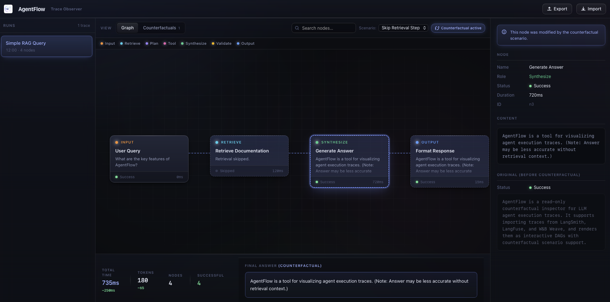
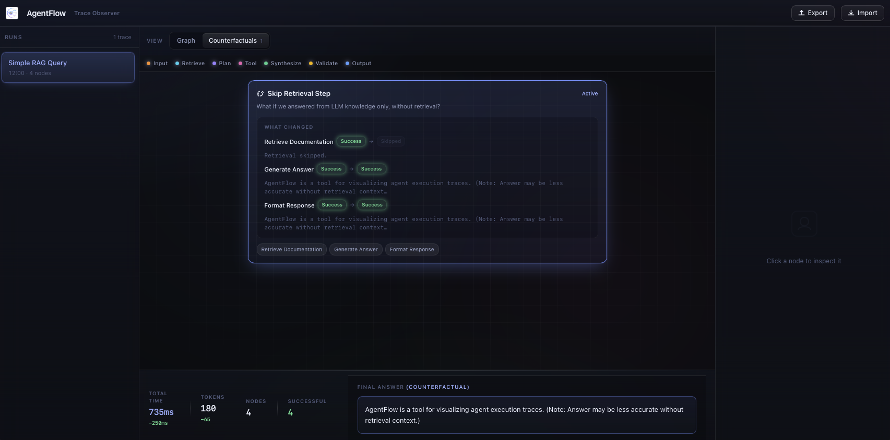
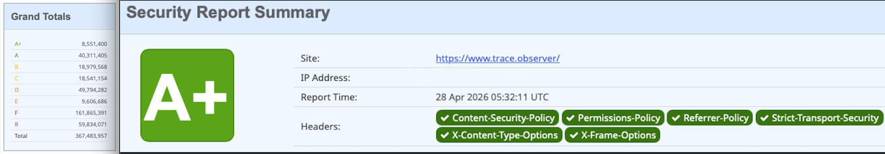
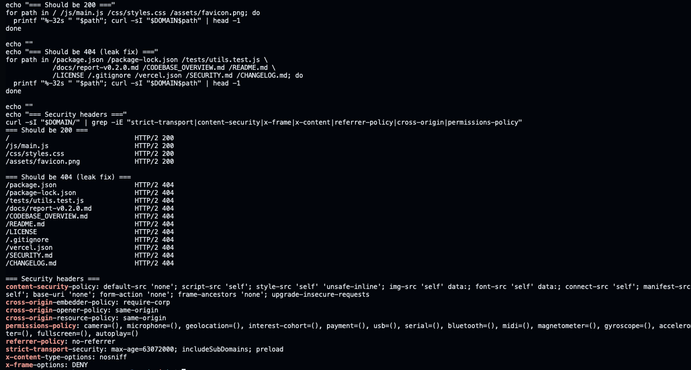
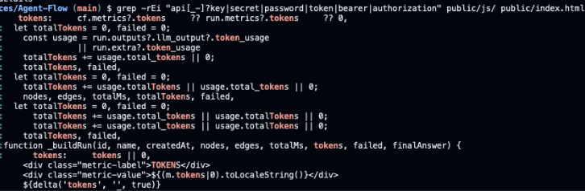
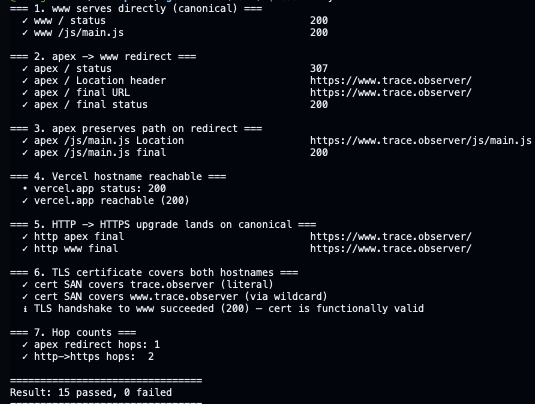

# AgentFlow

**Read-only counterfactual inspector for LLM agent execution traces.**

Import a trace exported from LangSmith, LangFuse, or W&B Weave — or a native `.agentflow.json` file. AgentFlow renders the execution as an interactive directed acyclic graph, lets you flip between the original run and any embedded counterfactual scenarios, and shows exactly which nodes changed, how the metrics shifted, and what the final answer would have been.

Zero build step. Zero runtime dependencies. One HTML file, eight JavaScript modules, one stylesheet.

---

## Preview


<p align="center">
  
</p>


<p align="center">
  
</p>

---

## Script load order

```txt
constants.js
    └─▶ utils.js
            └─▶ data.js
                    └─▶ state.js
                            └─▶ layout.js
                                    └─▶ adapters.js
                                            └─▶ render.js
                                                    └─▶ events.js
                                                            └─▶ main.js
````

Each file may only use names introduced by files above it in this list. There are no circular dependencies.

---

## Security model

<p align="center">
  
</p>

### SecurityHeaders A+

<p align="center">
  
</p>

### Platform scan overview

<p align="center">
  
</p>

### Infrastructure validation

<p align="center">
  
</p>

---

## Status

All known release blockers have been resolved. The application has passed static deployment validation, security-header validation, canonical redirect checks, TLS verification, and bundle secret scanning.

Verified:

* `assets/favicon.png` is present and correctly referenced via `<link rel="icon">` in `index.html`.
* The CSP directive in the `<meta http-equiv="Content-Security-Policy">` tag matches the deployed `Content-Security-Policy` HTTP header.
* SecurityHeaders reports an **A+** grade for `https://www.trace.observer/`.
* HTTPS canonicalization is working:

  * apex redirects to `https://www.trace.observer/`
  * `/js/main.js` preserves path on redirect
  * final canonical responses return `200`
* TLS certificate validation succeeds for both apex and `www` hostnames.
* Internal project/source files are not publicly exposed and return `404`.
* Static bundle secret scan found no API keys, secrets, passwords, bearer tokens, or authorization credentials.
* Matches are limited to non-sensitive token-count fields such as `token_usage`.
* All required security HTTP headers are present:

  * `Content-Security-Policy`
  * `Permissions-Policy`
  * `Referrer-Policy`
  * `Strict-Transport-Security`
  * `X-Content-Type-Options`
  * `X-Frame-Options`
  * `Cross-Origin-Opener-Policy`
  * `Cross-Origin-Resource-Policy`
  * `Cross-Origin-Embedder-Policy`
* All 260 unit tests pass (`npm test`).

---

*Copyright © 2026 Omry Damari - Visigence. All rights reserved.*
*Proprietary and confidential. See `LICENSE` for terms.*
*Security disclosures: see `SECURITY.md`.*
